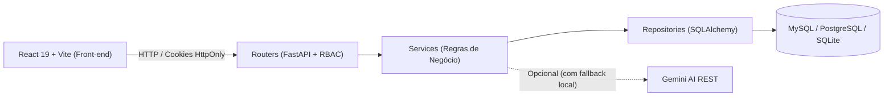

# Mercado do Lucca — Sistema de Supermercado (TDE Back-End)

Aplicação full-stack de supermercado desenvolvida com **FastAPI + SQLAlchemy + MySQL** (com suporte a PostgreSQL e fallback automático para **SQLite**) e **React 19 + Vite + Tailwind CSS v4**.

O projeto cobre integralmente os requisitos da disciplina:
- **CRUD completo de Produtos** (`cadastrar`, `listar`, `editar`, `ajustar estoque` e `excluir`)
- **Simulação de Compra** em formato de gôndola com cupom fiscal ao vivo e persistência do carrinho
- **Controle de Estoque** com baixa atômica transacional a cada venda e bloqueio por estoque insuficiente
- **Regra de Negócio** aplicando **5% de desconto** apenas em compras com valor bruto **superior a R$ 200,00** (`valor_bruto > 200.00`)
- **Autenticação e RBAC** (`gerente` e `cliente`) com JWT em cookies `HttpOnly` e refresh tokens revogáveis
- **Consultor de Estoque (IA)** via **Gemini AI** com motor analítico local automático em fallback

---

## Arquitetura do Sistema

O back-end segue uma arquitetura em camadas (`routers` → `services` → `repositories` → `models`), separando entrada HTTP, regras de negócio, acesso a dados e persistência:



### Onde está cada requisito no código

| Requisito | Back-end | Front-end |
| :--- | :--- | :--- |
| **CRUD de Produtos** | `backend/routers/produto_router.py` → `backend/services/produto_service.py` → `backend/repositories/produto_repository.py` | `frontend/src/components/EstoqueView.jsx` |
| **Simulação de Compra** | `backend/routers/venda_router.py` → `backend/services/venda_service.py` → `backend/repositories/venda_repository.py` | `frontend/src/components/CaixaView.jsx` |
| **Baixa Atômica de Estoque** | `backend/repositories/produto_repository.py` (`baixar_estoque_atomico`) + `backend/services/venda_service.py` | Atualização imediata da gôndola e tabela após `POST /vendas/` |
| **Desconto de 5% (> R$ 200,00)** | `backend/services/venda_service.py` (`LIMITE_DESCONTO`, `PERCENTUAL_DESCONTO`) | `frontend/src/utils/format.js` + `CaixaView.jsx` + `HistoricoView.jsx` |
| **Consultor de Estoque (IA)** | `backend/routers/insight_router.py` → `backend/services/insight_service.py` | `frontend/src/components/InsightEstoqueCard.jsx` |
| **Autenticação e RBAC** | `backend/routers/auth_router.py` → `backend/services/auth_service.py` + `backend/core/auth_dependencies.py` + `backend/core/security.py` | `frontend/src/components/LoginView.jsx` + `frontend/src/App.jsx` + `frontend/src/services/api.js` |
| **Modelagem e Banco** | `backend/models/` + `backend/core/database.py` + `backend/core/sync_db.py` | — |

---

## Modelagem no Banco de Dados

| Tabela | Model | Principais Campos e Comportamento |
| :--- | :--- | :--- |
| `produtos` | `Produto` | `id_produto`, `nome`, `categoria`, `unidade`, `preco`, `quantidade_estoque` |
| `vendas` | `Venda` | `id_venda`, `data_hora`, `valor_bruto`, `desconto_aplicado`, `valor_final`, `teve_desconto` |
| `itens_venda` | `ItemVenda` | `id_item`, `id_venda` (`ON DELETE CASCADE`), `id_produto` (`ON DELETE SET NULL`), `nome_produto`, `preco_unitario`, `quantidade`, `subtotal` — guarda snapshot do item para preservar o histórico mesmo se o produto for excluído |
| `usuarios` | `Usuario` | `id_usuario`, `nome`, `login` (único), `senha_hash` (`bcrypt`), `perfil` (`gerente` \| `cliente`) |
| `refresh_tokens` | `RefreshToken` | `id_token`, `id_usuario` (`ON DELETE CASCADE`), `token_hash` (SHA-256), `expires_at`, `revoked` |

---

## Endpoints da API

| Método | Rota | Acesso | Descrição |
| :--- | :--- | :--- | :--- |
| `GET` | `/` e `/health` | Público | Status da API e backend de banco ativo |
| `POST` | `/auth/login` | Público | Autentica usuário e grava `access_token` e `refresh_token` em cookies `HttpOnly` |
| `POST` | `/auth/registrar` | Público | Cria nova conta com perfil `cliente` e inicia sessão |
| `POST` | `/auth/refresh` | Cookie `refresh_token` | Rotaciona o refresh token e emite novo access token |
| `POST` | `/auth/logout` | Sessão | Revoga o refresh token no banco e limpa os cookies |
| `GET` | `/auth/me` | Autenticado | Retorna os dados do usuário logado |
| `GET` | `/produtos/` | Autenticado | Lista produtos ordenados por nome |
| `GET` | `/produtos/{id_produto}` | Autenticado | Busca um produto pelo ID |
| `POST` | `/produtos/` | Gerente | Cadastra um novo produto |
| `PUT` | `/produtos/{id_produto}` | Gerente | Atualiza todos os dados de um produto |
| `PATCH` | `/produtos/{id_produto}/estoque` | Gerente | Ajusta o estoque por `delta` (travado em `0` como mínimo) |
| `DELETE` | `/produtos/{id_produto}` | Gerente | Remove o produto mantendo o histórico em `itens_venda` |
| `GET` | `/vendas/` | Gerente | Lista vendas registradas (com paginação `limit` e `offset`) |
| `POST` | `/vendas/` | Autenticado | Agrupa itens, realiza baixa atômica no estoque e calcula desconto (> R$ 200,00) |
| `GET` | `/insights/estoque` | Gerente | Gera resumo executivo, recomendações e alertas de reposição |

---

## Como Executar Localmente

### Pré-requisitos
- **Python 3.12+**
- **Node.js 20+** e npm
- **MySQL** local (opcional — caso esteja desligado, a API utiliza automaticamente `backend/supermercado.db` em SQLite)

### 1. Configurar variáveis de ambiente (Back-end)

Crie o arquivo `backend/.env` a partir de `backend/.env.example`:

```bash
cd backend
cp .env.example .env
```

> **Importante:** defina uma `SECRET_KEY` com **pelo menos 16 caracteres seguros** (a aplicação recusa iniciar com a chave padrão de exemplo). Opcionalmente, preencha `GEMINI_API_KEY` para ativar recomendações via Gemini (`gemini-3.1-flash-lite`); sem chave ou sem acesso externo, o endpoint `/insights/estoque` usa automaticamente a análise local.

### 2. Iniciar o Back-end (FastAPI)

```bash
cd backend
pip install -r requirements.txt
uvicorn main:app --reload
```

- API disponível em: `http://localhost:8000`
- Documentação interativa (Swagger): `http://localhost:8000/docs`

Na primeira inicialização, o evento `lifespan` cria as tabelas e popula automaticamente **10 produtos iniciais** e **2 contas padrão**:

| Perfil | Login | Senha | Acesso na Interface |
| :--- | :--- | :--- | :--- |
| **Gerente** | `gerente` | `gerente123` | Caixa / Simulação, Produtos e Estoque, Histórico de Vendas e Insights IA |
| **Cliente** | `cliente` | `cliente123` | Caixa / Simulação |

*(Opcional)* Para sincronizar manualmente dados entre o SQLite local e MySQL/PostgreSQL configurado no `.env`:

```bash
cd backend
python -m core.sync_db --direcao sqlite-para-remoto
```

### 3. Iniciar o Front-end (React + Vite)

Em outro terminal:

```bash
cd frontend
npm install
npm run dev
```

- Interface disponível em: `http://localhost:5173`

---

## Testes Automatizados e CI

### Back-end (`pytest`)

```bash
cd backend
pytest test_api.py -v --cov=. --cov-report=term-missing
```

- **31 testes** validando autenticação com cookies `HttpOnly`, rotação e revogação de refresh tokens, RBAC (`401`/`403` entre `cliente` e `gerente`), CRUD completo, erros `404` e `422`, fronteira exata de **R$ 200,00** vs **R$ 200,01**, agrupamento de itens repetidos, baixa atômica de estoque, rollback, preservação de histórico após exclusão, insights via Gemini/fallback local e inicialização/migração de banco (`98%` de cobertura total no back-end, com `100%` em `routers/`, `services/`, `schemas/` e `models/`).

### Front-end (`Vitest + React Testing Library`)

```bash
cd frontend
npm run test:coverage
```

- **18 testes** em `App.test.jsx`, `api.test.js` e `format.test.js`, validando login/registro, RBAC nas rotas, persistência da cesta no `localStorage`, auto-refresh em `401`, cálculo em centavos, CRUD de produtos e geração de insights (`98,63%` de cobertura em linhas).

### Integração Contínua

O workflow [ci.yml](.github/workflows/ci.yml) executa automaticamente em `push` e `pull_request` para `main` as suítes `pytest` (back-end) e `vitest` + `vite build` (front-end).

---

## Estrutura do Projeto e Deploy

```text
TDEBACKEND/
├── .github/workflows/ci.yml   # Pipeline de testes (pytest + Vitest + Vite build)
├── Dockerfile                 # Container da API FastAPI para produção
├── render.yaml                # Blueprint de deploy do back-end + PostgreSQL no Render
├── backend/
│   ├── core/                  # Config (.env), conexão SQLAlchemy, JWT/bcrypt, RBAC e sync_db
│   ├── models/                # Tabelas ORM (Produto, Venda, ItemVenda, Usuario, RefreshToken)
│   ├── repositories/          # Consultas e operações atômicas no banco
│   ├── routers/               # Endpoints REST (/auth, /produtos, /vendas, /insights)
│   ├── schemas/               # Contratos Pydantic de entrada e saída
│   ├── services/              # Regras de negócio, cálculo de desconto e integração Gemini
│   ├── main.py                # Aplicação FastAPI, CORS e seed inicial
│   └── test_api.py            # Suíte de testes automatizados da API
└── frontend/
    ├── src/
    │   ├── components/        # LoginView, CaixaView, EstoqueView, HistoricoView, InsightEstoqueCard
    │   ├── services/          # Cliente Axios com cookies e auto-refresh JWT
    │   └── utils/             # Formatação BRL/data e cálculo em centavos
    └── vercel.json            # Proxy /api/* para a API em produção e rewrite SPA
```
